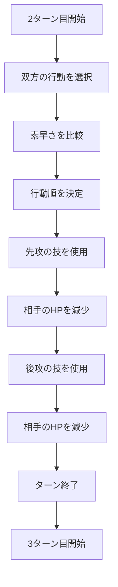

# STEP 01 基本の1ターン

CASE-01（2ターン目以降の通常攻撃）を、1対1の1ターンとして最後まで動かす。

この文書は STEP 01 の計画である。実装は `src/domain` にある。確認は `npm test`。ドメインの関係は `docs/domain.drawio` を参照する。完了後は STEP 02 の行動順決定へ進む。

## ゴール

2ターン目の状態と双方の攻撃を入力し、次を満たす。

- 素早さが高い方が先に攻撃する。
- 固定ダメージで相手の HP が減る。
- 起きたことが 8 件、仕様の順で残る。
- 処理後のターン番号が 3 になる。

進行は `runTurn` の手順が持つ。出来事はその手順が積む結果ログである。購読やハンドラはこの STEP では作らない。

## シナリオ

実装対象は CASE-01 のみ。

| 条件 | 内容 |
|---|---|
| 開始 | 2ターン目。双方が場にいる |
| 行動 | 双方が攻撃。優先度は同じ |
| 素早さ | 異なる |
| 技 | 必ず成功し、命中する |
| ダメージ | 固定値 |
| なし | 特性、持ち物、状態異常、追加効果、ひんし、交代 |

サンプルは動作確認用の仮データであり、種族値やダメージ計算ではない。エンジンは名前を特別扱いしない。ピカチュウが先攻になる理由は素早さ 90 > 45 である。

| 項目 | ピカチュウ | フシギダネ |
|---|---|---|
| 開始時 HP | 100 | 100 |
| 素早さ | 90 | 45 |
| 行動 | 攻撃 | 攻撃 |
| 与ダメージ | 20 | 15 |
| 行動順 | 先攻 | 後攻 |
| 終了時 HP | 85 | 80 |
| 終了時 | 生存 | 生存 |

途中の HP は次のとおり。

| 時点 | ターン | ピカチュウ HP | フシギダネ HP |
|---|---|---|---|
| 開始 | 2 | 100 | 100 |
| 先攻の攻撃後 | 2 | 100 | 80 |
| 後攻の攻撃後 | 2 | 85 | 80 |
| ターン終了後 | 3 | 85 | 80 |

## アルゴリズム



`runTurn` が行うのは I までである。J は「次に `runTurn` を呼ぶと 3ターン目になる」状態を作るところまでとする。3ターン目の行動はこの STEP では実行しない。

## 入出力

### 入力

1対1。双方の攻撃が揃っている前提で受け取る。行動の欠け、交代、優先度の違いは受け取らない。

```text
Battle
  turn: 2
  pokemon:
    pikachu:   { name: ピカチュウ, hp: 100, speed: 90 }
    bulbasaur: { name: フシギダネ, hp: 100, speed: 45 }

Actions
  pikachu:   { kind: attack, damage: 20 }
  bulbasaur: { kind: attack, damage: 15 }
```

識別子はサンプルでは `pikachu` と `bulbasaur` とする。比較とログが使うのはこの識別子と `speed` と `damage` であり、表示名ではない。

### 出力

`runTurn` は更新後のバトルと、出来事の列を返す。

```text
Battle
  turn: 3
  pokemon:
    pikachu:   { hp: 85, speed: 90 }
    bulbasaur: { hp: 80, speed: 45 }

Events
  長さ 8。下表の順
```

素早さと名前は変化しない。HP は 0 以下にしない入力だけを扱う。0 以下の扱いは STEP 04 まで書かない。

## 出来事

名前は仮。テストが固定するのは順序と、各件の内容。

| 順 | 名前 | 記録する内容 |
|---|---|---|
| 1 | TurnStarted | 開始ターン `2` |
| 2 | ActionsSelected | 双方の `attack` とダメージ `20` / `15` |
| 3 | ActionOrderDetermined | 先攻 `pikachu`、後攻 `bulbasaur` |
| 4 | MoveUsed | 使用者 `pikachu` |
| 5 | DamageApplied | 対象 `bulbasaur`、減少 `20`、減少後 HP `80` |
| 6 | MoveUsed | 使用者 `bulbasaur` |
| 7 | DamageApplied | 対象 `pikachu`、減少 `15`、減少後 HP `85` |
| 8 | TurnEnded | 終了したターン `2` |

`MoveUsed` は HP を変える前に積む。`DamageApplied` は HP を減らしたあとに積み、減少後 HP を載せる。`TurnEnded` を積んでから `turn` を 1 増やす。

## 処理手順

1. `TurnStarted` に現在の `turn` を載せて積む。
2. 双方の行動を受け取り、`ActionsSelected` を積む。
3. `orderBySpeed` で行動順を決める。素早さが大きい方を先攻にする。
4. `ActionOrderDetermined` に先攻と後攻を載せて積む。
5. 先攻について `MoveUsed` を積み、相手 HP から固定ダメージを引き、`DamageApplied` を積む。
6. 後攻について同じことを行う。
7. `TurnEnded` に、加算前のターン番号を載せて積む。
8. `turn` を 1 増やす。

攻撃は必ず 2 回行う。残行動の確認や中断はこの手順に書かない。

### 行動順

`orderBySpeed` はターン手順から切り離した 1 関数にする。STEP 01 の中身は素早さの大小だけ。

```text
orderBySpeed(a, b):
  a.speed > b.speed なら [a, b]
  それ以外で b.speed > a.speed なら [b, a]
```

CASE-01 の入力は同速にしない。同速、優先度、トリックルームの仕様は STEP 02 でこの関数に足す。

## 責務の分け方

| 責務 | 持つもの | 持たないもの |
|---|---|---|
| 状態 | ターン番号、2 体の HP と素早さ | 特性、持ち物、状態異常 |
| 行動 | 攻撃であることと固定ダメージ | 命中、優先度、追加効果 |
| 行動順 | 素早さの大小 | 同速の抽選、トリックルーム |
| ターン手順 | 上記 8 手順と HP の減算 | ひんし判定、勝敗判定、交代 |
| 出来事 | 発生順の列 | 購読、ハンドラ、連鎖 |

登場時処理、ひんし判定、勝敗判定、特性、持ち物は STEP 01 では関数も呼び出しも作らない。

## テスト

CASE-01 を 1 本のテストにし、完了条件をまとめて確認する。

| 確認 | 期待 |
|---|---|
| 2ターン目から実行できる | 入力の `turn` が 2 |
| 双方の行動を受け付ける | `ActionsSelected` に 20 と 15 がある |
| 素早さで行動順が決まる | 先攻が `pikachu`、後攻が `bulbasaur` |
| 先攻のあと後攻が攻撃する | `MoveUsed` の使用者がその順 |
| HP がダメージ分減る | 終了時 HP が 85 と 80。途中のフシギダネは 80 |
| 出来事が順序どおり | 8 件の名前が上表と一致する |
| 3ターン目へ進む | `TurnEnded` のターンが 2 で、状態の `turn` が 3 |

名前ではなく素早さで順が決まることを、もう 1 本で確認する。CASE-01 の素早さだけを入れ替え、与ダメージはそのままにする。

| 項目 | ピカチュウ | フシギダネ |
|---|---|---|
| 素早さ | 45 | 90 |
| 与ダメージ | 20 | 15 |
| 行動順 | 後攻 | 先攻 |
| 終了時 HP | 85 | 80 |

先攻がフシギダネになるため、先にピカチュウの HP が 85 になり、そのあとフシギダネの HP が 80 になる。終了時 HP は CASE-01 と同じである。

## 実装する順

1. バトル、ポケモン、行動、出来事の形を固定する。
2. `orderBySpeed` を単独で実装する。
3. `runTurn` を 8 手順で実装し、HP 更新と出来事の記録を同じ順で行う。
4. CASE-01 のテストを書き、完了条件を確認する。
5. 素早さを入れ替えたテストを書き、行動順が識別子に依存していないことを確認する。

## 対象外

本格的なダメージ計算、技の優先度、同速のランダム、命中と回避、急所、タイプ相性、状態異常、特性、持ち物、追加効果、ひんし、ポケモン交代、天候とフィールド。

複数ターンの連続実行、行動のバリデーション、イベント名の確定もこの STEP の完了には含めない。

## 完了条件

- [x] 2ターン目の状態から実行できる
- [x] 双方の行動を受け付けられる
- [x] 素早さによって行動順が決定する
- [x] 先攻・後攻の順番に攻撃が実行される
- [x] ダメージに応じて HP が減少する
- [x] 発生した出来事を順序どおりに確認できる
- [x] ターン終了後、3ターン目に移行できる

## 次の STEP への接続

STEP 02 で変えるのは `orderBySpeed` の中身である。優先度、同速、トリックルーム、行動順に影響する効果を、この関数の入力と判定に足す。`runTurn` の 8 手順と出来事の並びは、行動順の結果を受け取る側として残す。
